<h3 align="right">who are you?</h3>

I’m **Zach Stone**, a senior software engineer in Fukushima, Japan, working US hours.
I take customer problems from the first conversation to production: full-stack TypeScript, Cloudflare Workers, and LLM and MCP integrations. I work in English and Japanese (JLPT N1).

  

<h3 align="right">what do you do at work?</h3>

I’m a **Senior Software Engineer at Sellfire**, a B2B sales-engagement platform, in a forward-deployed, full-stack role. I’ve spent four years on the product, where I’m the web app’s top contributor and the primary author of more than ten services built around it.

- **LinkedIn outreach service.** Sent 2,450+ connection invites at about a 12% accept rate. In the pilot, leads who accepted reached decision makers 2× as often and booked demos 4–5× as often.
- **Website visitor identification.** Matches a customer’s website visitors to their existing leads, alerts the lead’s rep and moves the lead up their call queue. It was matching real visits in production the day after the request.
- **Call-script service and MCP server.** Staff and AI agents publish script changes with no engineering deploy: 38 customer accounts, 180+ script versions.
- **The web app.** Led its React 16 → 18 migration across 216 files with zero downtime, and cut the load time of reps’ call queue by 64%.

  

A sales call leads to a LinkedIn invite, and the lead’s answer comes back to the rep’s call queue.

<h3 align="right">what do you build for yourself?</h3>

- **[claude-app-portfolio-template](https://github.com/ZacharyTStone/claude-app-portfolio-template).** A portfolio laid out like the Claude app, open for anyone to make their own. Static Astro that works without JavaScript, a strict Content Security Policy with Trusted Types, and an optional Ask Worker that answers typed questions from the site’s own words and shows the lines it used.
- **[zstone.dev](https://zstone.dev).** My own site, made from that template. Ask it something.
- **[Business Japanese Practice](https://businessjapanesepractice.com).** An adaptive practice app for a business Japanese exam, on the web and Android. A nightly pipeline has Claude write original questions, which other models and fixed rules check before a pull request publishes them.

  

From the template: a Worker runs wherever a visitor is, and they all ask one Durable Object. Every picture on this page is an SVG written by <a href="https://github.com/ZacharyTStone/claude-app-portfolio-template/blob/main/scripts/diagram.ts">a small TypeScript kit</a> in that repo. No GIFs.

<h3 align="right">what do you work with?</h3>

**Languages** · TypeScript, JavaScript, HTML, CSS 
**Frontend** · React, Next.js, Svelte / SvelteKit, Zustand / Jotai, Apollo Client, Tailwind CSS, Vite 
**Backend and cloud** · Cloudflare Workers (D1, KV, R2, Hyperdrive, Durable Objects), Node.js, PostgreSQL, GraphQL, AWS Lambda, Terraform, GitHub Actions 
**AI** · Claude API, Agent SDK, MCP servers, Claude Code skills and plugins, multi-agent review pipelines 
**Also** · Sentry, PagerDuty, New Relic, LaunchDarkly, Mixpanel, Playwright, Twilio, LiveKit / WebRTC

<h3 align="right">日本語は？</h3>

JLPT N1です。日本語でのご連絡も歓迎します。日本語のポートフォリオは [zstone.dev/ja](https://zstone.dev/ja/) にあります。

<h3 align="right">how do I reach you?</h3>

**[zstone.dev](https://zstone.dev)** · **[LinkedIn](https://www.linkedin.com/in/zacharystone42/)**
